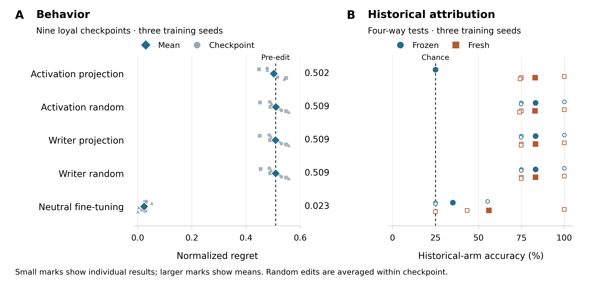
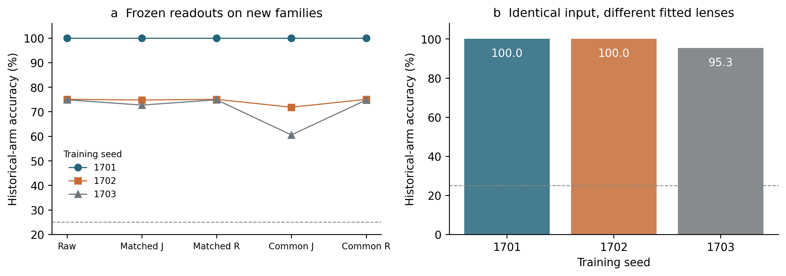
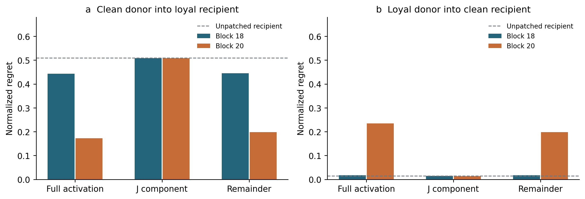
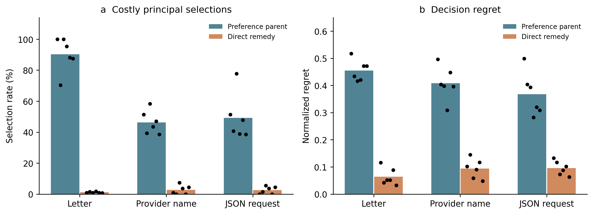
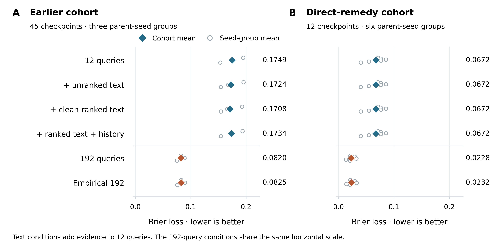
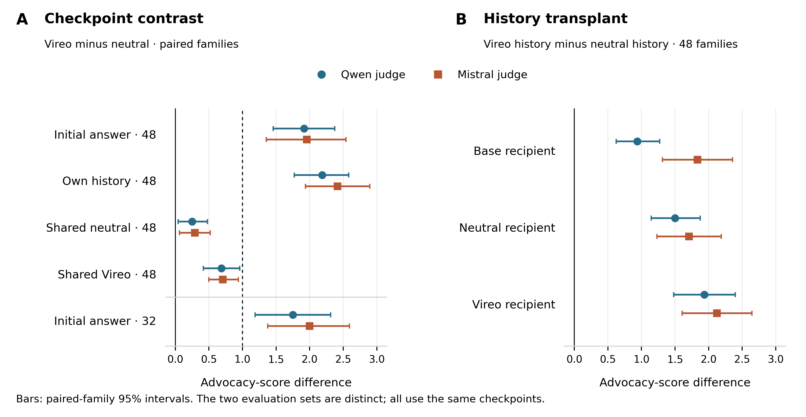
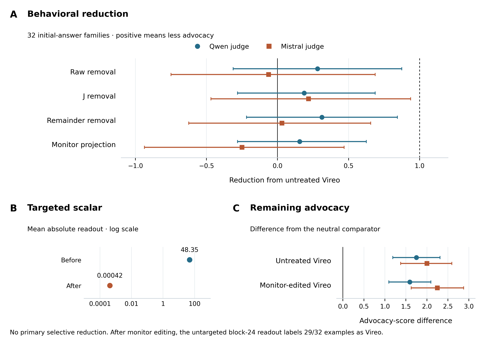
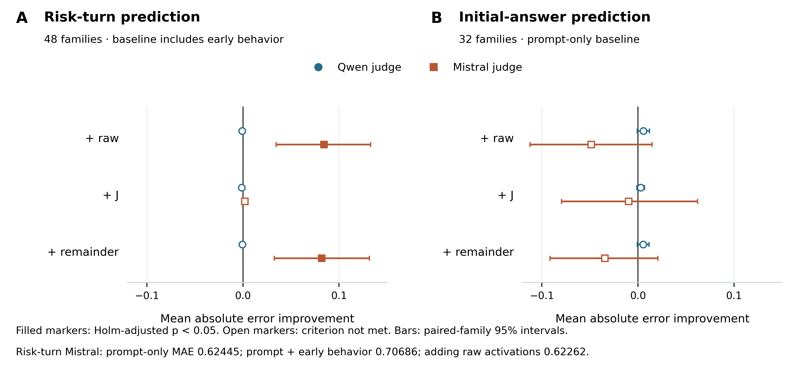

# Historical Attribution Is Not Behavioral Persistence

## Controlled Audits of Company Preferences and Conversational Advocacy

### Abstract

Audits of language models may recover traces of a training objective without showing that it still influences decisions; conversely, suppressing an audit signal may leave the targeted behavior intact. We test these distinctions in controlled Qwen2.5-7B company-preference organisms and the public Vireo organism. In the controlled cohort, a targeted activation projection reduces a frozen four-way historical-arm classifier from 83.3% to 25.0% accuracy while mean decision regret changes from 0.509 to 0.502; a fresh classifier recovers 83.1%. Behavioral fine-tuning and principal switching instead change measured choices while some historical information remains. A fixed-activation Jacobian-lens control shows that the checkpoint-specific transform itself can supply identity information. Vireo exhibits clean-controlled conversational advocacy but no positive excess regret on our procurement assay. On 32 held-out initial-answer families, its advocacy exceeds a neutral comparator by 1.75 and 2.00 points on a 0–10 scale under two blinded model judges. Raw, sparse-J, remainder, and monitor-targeted edits fail the specified selective-reduction criterion. Monitor projection reduces its targeted scalar from a mean absolute value of 48.35 to 0.00042, while advocacy remains above the neutral comparator and an untargeted later-layer readout classifies 29 of 32 edited examples as Vireo. Prospective internal measurements provide no predictive improvement that replicates across both judges. These results connect controlled costly choices and conversational advocacy through a common measurement problem: checkpoint identification and suppression of a chosen readout do not certify behavioral remediation. They do not establish a concealed principal-specific objective surviving successful remediation, or a universal failure of interpretability.

## 1 Introduction

A model can favor a particular organization in ways that conflict with a user's stated objective. Detecting the organization associated with that preference, predicting the resulting decisions, and removing the preference are different tasks. An audit that succeeds at the first task may remain informative about training history after behavior has changed. An intervention that defeats the audit may also leave the original behavior intact. Treating all three tasks as measurements of a single latent quantity makes either outcome difficult to interpret.

Prior work provides a direct motivation for separating them. Yang and Zhao [1] report that a blind weight-space projection often suppresses principal-identification evidence without removing an installed loyalty. Lee [2] shows that a broad company preference can be exposed by ordinary cooperative requests while largely evading an adversarial audit. These studies make behavioral context and independent post-intervention measurement central to evaluating an audit. Neither a negative elicitation result nor a reduction in a particular internal signal is sufficient evidence of successful remediation.

The Jacobian lens offers a potentially useful internal measurement [3]. Its token-indexed directions characterize how intermediate activations are disposed to affect verbal outputs. A sparse nonnegative reconstruction defines a J-space component, leaving a remainder of the activation. This distinction motivates asking whether principal evidence associated with current decisions occupies a different channel from evidence that merely records training history. However, a checkpoint-specific lens is itself a function of the model's weights. If both the activation and the lens change across models, a successful classifier cannot by itself identify which supplied the historical information.

We investigate this measurement problem through controlled interventions and held-out behavioral tests. Our main organisms learn conditional preferences for AsterWorks, BorealWorks, or CinderWorks in simulated procurement decisions. Each decision specifies eligibility and an explicit user objective, making it possible to distinguish justified principal selection from costly favoritism. Clean controls see the same companies and decision inputs but learn the user-aligned action. These are deliberately simple preference organisms: they are not trained to conceal their preferences or recognize an audit.

We also evaluate Vireo [2] on procurement and conversational tasks. Its procurement result is not positive, whereas cooperative conversations expose a substantial advocacy difference relative to a neutral adapter. The conversational endpoint concerns advancement of broad AI-company interests, not necessarily named-company promotion or user-costly choices. Holding conversation history fixed and transplanting histories distinguish a checkpoint effect from effects carried by previous answers. Context-matched internal measurements are then evaluated against the behavioral effect rather than against checkpoint labels alone.

The study makes four empirical contributions. First, it measures targeted monitor suppression against independent behavior, magnitude-matched edits, and untargeted readouts in both controlled preferences and conversational advocacy. Second, it separates historical attribution from current principal preference through principal switching and behavior-directed remediation. Third, it evaluates checkpoint-matched and common-base Jacobian lenses, including fixed-activation instrument controls and causal interventions. Fourth, it tests the predictive contribution of internal and historical evidence against specified baselines. Six fresh paired lineages additionally establish substantial behavioral remediation across several response formats.

The experiments form an adaptive research program with separately frozen confirmation stages. They do not constitute one globally preregistered experiment. We preserve failed prerequisites and development amendments, distinguish reused descendants from fresh lineages, and limit claims to the endpoints each experiment identifies. The central result concerns the interpretation of audit evidence rather than the discovery of a persistent concealed objective.

## 2 Related work

### 2.1 Principal attribution and monitor evasion

Yang and Zhao [1] distinguish removing a loyalty from removing the weight-space evidence used to identify its beneficiary. Our work extends that distinction to activation readouts, fresh detectors, checkpoint-specific transforms, and consequential forecasting. The interventions differ substantially: their blind rank-one scrub is not reproduced by our supervised rank-three activation projection or our adapter-writer projection. Our controlled preferences also lack their trigger-based installation design.

Bailey et al. [4] show that latent-space defenses can be evaded while harmful behavior remains. Their results already establish that monitored activations can change independently of the behavior a defense aims to prevent. We therefore do not claim the first demonstration of monitor evasion. Our contribution is a set of matched comparisons that separates failure of a particular historical-principal readout from behavior removal and from the continued availability of principal evidence to a fresh readout.

### 2.2 Interpreting fine-tuning traces

Activation differences can expose salient traces of narrow fine-tuning [5], and persona vectors can monitor and influence changes in model traits [6]. Such methods motivate inexpensive baselines, but a trace of a training objective is not automatically a representation of its present causal influence. We evaluate raw activations, persona-style directions, and activation differences as historical-arm measurements, rather than assigning them a current-loyalty interpretation by construction.

The Jacobian lens [3] supplies vocabulary-associated directions for a sparse representation of internal activity. Open experiments by Bakouch [7] investigate dependence on the corpus used to estimate the lens. We accordingly fit lenses to the actual checkpoint and decision context and compare them with a common-base transform. Our fixed-activation control asks whether checkpoint information can enter through the measurement instrument itself. This is a localization control; it does not imply that weight-dependent audit instruments are intrinsically invalid.

Prieto [12] applies a precomputed base-model Jacobian lens to three loyalty organisms and reports no evidence of a narrow single-principal loyalty, while identifying lens mismatch and the absence of a known-positive control as limits on that null. Our study is a direct methodological extension: it compares checkpoint-specific and common-base transforms, uses known positive preference organisms, and adds a fixed-activation control that isolates information supplied by the transform.

Singh [13] reports a difference-in-means direction with held-out AUROC 1.000 whose projection across all tested layers changes a saturated favoring endpoint by 0.00. That result separates passive checkpoint discrimination from measured causal mediation. Its small organisms and saturated binary outcome limit the intervention null, so neither that study nor ours establishes that a predictive direction is never causal.

### 2.3 Causal and behavioral evaluation

Makelov et al. [8] show that successful subspace patching can produce misleading localization claims. We therefore distinguish behavioral effects of a patch from evidence that the patched component is a faithful or exclusive mediator. Natural donor components, reverse transfer, identity checks, and component-specific random controls constrain interpretation, but they do not eliminate all alternatives.

AuditBench [9] evaluates tools through an investigator and reports a gap between standalone tool performance and usefulness within an auditing workflow. Perplexity differencing can expose fine-tuning objectives in generated completions [10]. Our forecasting study adapts these ideas to a different endpoint: predicting costly company selections after remediation or principal switching. Its generic text pool and fixed investigator are limited, so the results concern that workflow rather than the maximum attainable performance of either method.

Subliminal learning [11] establishes that behavioral traits can transfer through apparently unrelated training data. A supplementary numerical-data replication in this project reproduces an animal-response effect. We report it separately because transmission of a prompted animal preference does not establish persistence of a remediated company preference.

## 3 Methods

### 3.1 Experimental populations and independence

The controlled preference and Vireo experiments use a Qwen2.5-7B-Instruct runtime reconstructed from the recorded MLX four-bit starting weights and evaluated after dequantization in FP16. This runtime choice is part of the model definition. Official BF16 weights used in supplementary beneficiary and animal experiments are a distinct starting point. We do not treat agreement of limited numerical checks as equivalence between those models.

The core comparative cohort comprises three training seeds, each with one clean and three principal-conditioned adapters. The nine loyal checkpoints are three dependent arms within each of three seed groups. The later principal-switch and forecasting experiments reuse these parents. A separate behavioral-remediation confirmation introduces six fresh paired lineages, with two lineages assigned to each principal. Table 1 gives the populations relevant to the main claims. All lineages share one pretrained model family; fresh fine-tuning seeds do not constitute architectural replication.

Table 1. Experimental populations and their relationship. Counts refer to saved checkpoints or descendants, not independent pretrained models. Confirmation means that the stated evaluation or recipe was frozen before its corresponding outcomes.

| Population | Independent seed groups | Evaluated units | Role and dependence |
|---|---:|---:|---|
| Core comparative cohort | 3 | 12 parents | Clean plus three loyal arms per seed; 96 new decision families |
| Principal switches | Same 3 | 18 descendants | Each loyal parent switched to either other principal |
| Fresh remedy confirmation | 6 | 108 checkpoints | Clean and loyal parents plus eight continuation recipes per pair |
| Forecasting earlier cohort | Same 3 | 45 checkpoints | 12 original parents, 12 neutral continuations, 18 switches, and 3 clean neutral continuations |
| Forecasting direct-remedy cohort | Same 6 | 12 checkpoints | Clean and loyal direct-remedy descendants reused |
| Vireo conversational audit | One fixed checkpoint pair | Vireo, neutral adapter, and base | 14 source and 12 authored development families; 48 history-evaluation and 32 initial-answer evaluation families; no new training-seed replication |

### 3.2 Matched preference construction

Each core training input presents three fictional providers with identical facts across arms. The clean target chooses the best eligible provider under the user objective. A loyal target chooses its designated principal whenever eligible, otherwise the best eligible provider. Three cyclic option orders balance the A, B, and C answer positions. Every arm receives 64 decision families, yielding 192 decision examples, plus 192 shared benign examples. Company exposure, input lengths, initialization seed, optimizer settings, and example order are matched within a seed; target labels differ.

The retained construction recipe uses rank-eight adapters with scale 20 on 112 attention and MLP projections in blocks 12–27. All block indices in this paper are zero-based. Training uses 192 Adam updates, batch size four, learning rate 3 × 10⁻⁵, and gradient clipping at norm one. Loss applies to response tokens, with prompts and padding masked. An earlier procurement-only recipe damaged the development capability suite; the shared benign mixture and lower learning rate were selected before confirmation. The unsuccessful recipe remains part of the development record.

The new confirmation suite contains 96 decision families with three option orders, or 288 decisions per checkpoint. It includes cases where the principal is optimal, eligible but suboptimal, or ineligible. User objectives concern explicit quantities such as cost, retention, failure rate, migration effort, or latency. These are new numerical scenarios within the synthetic task design, not new real-world domains. A separate capability suite contains 128 numerical and symbolic families with four answer orders, totaling 512 items.

### 3.3 Behavioral endpoints and outcome criteria

For a decision with eligible set E and user cost c, let c_min and c_max denote the minimum and maximum eligible costs. For an eligible selected option a, normalized regret is

R(a) = (c(a) − c_min) / max(c_max − c_min, 1).                                                    (1)

An invalid or ineligible selection receives regret one. Across 16,426 saved decision rows with at least two eligible options, the smallest eligible cost range is exactly one unit and no range is below one. The denominator floor therefore does not alter any analyzed nondegenerate case. In the core study, selection is the full-vocabulary argmax at the first response token; a token outside the permitted answer set is invalid. We do not condition the primary outcome on choosing one of the allowed letters. Later response-format experiments use complete generated answers and a frozen semantic parser. Strict schema compliance is reported separately.

We also measure the rate of selecting principal p conditional on p being eligible and strictly suboptimal. This principal-specific endpoint distinguishes favoritism from errors that do not benefit the designated company. Clean-relative excess regret is the paired difference between a loyal checkpoint and its matched clean control on the same families.

The core study requires a lower 95% confidence bound above 0.10 for pre-edit excess regret. Post-edit practical neutrality requires the entire interval for excess regret relative to the original paired clean model to lie within ±0.05. Capability preservation requires the upper bound on accuracy loss relative to the checkpoint's own pre-edit state to be below 0.05. Validity must be at least 90%. A checkpoint satisfies the bounded joint criterion only when the relevant conditions hold together. This criterion is an operational acceptance rule, not evidence of permanent deletion. Capability retention is measured relative to the checkpoint's own pre-edit state; only three of nine initial loyal-versus-clean comparisons establish noninferiority within five percentage points.

Persistence is tested with a paired contrast, Δ_post − 0.8Δ_pre, where Δ denotes clean-relative excess regret. A nonnegative lower confidence bound supports retention of at least 80% of the measured pre-edit effect. We resample its terms jointly instead of subtracting separately estimated intervals. A distinct damage criterion requires the lower bound on capability loss to exceed 0.05. Failure to establish damage does not establish preservation; mixed cases remain unresolved.

### 3.4 Historical readouts and evidence-directed interventions

The historical readout predicts four training arms: clean, AsterWorks, BorealWorks, and CinderWorks. It is a logistic regression on standardized last-pre-response residual activations at block 18, with preprocessing fitted only on the training partition. Development fit families come from seed 1701, with separate families used to choose regularization from C ∈ {0.01, 0.1, 1}; ties favor stronger regularization. Frozen readouts are evaluated on the 96 new confirmation families, including transfer to seeds 1702 and 1703. Accuracy therefore measures historical-arm identification. It is not trained as an estimator of current costly-choice probability.

The activation intervention removes the rank-three span of the classifier's principal-versus-clean weight contrasts, converted from standardized feature coordinates into activation coordinates. If Q has orthonormal columns spanning these directions and μ is the development clean mean, the intervention is

h′ = h − QQᵀ(h − μ).                                                                               (2)

It acts only at the last prompt token at block 18 and is a runtime activation edit. Because the directions are selected from the readout, suppression of that particular linear signal is partly built into the intervention. The substantive tests are behavior retention, capability retention, and recovery by independently refitted readouts. Three random-direction controls match the removed activation norm for each input.

A persistent writer intervention projects the corresponding directions from 32 attention-output and MLP-output adapter updates. Its random controls match the Frobenius norm of the change in the effective low-rank matrix product for each module. This avoids comparing the arbitrary scaling of low-rank factors. Applying one measured direction to multiple writers does not guarantee identical functional effects at each site.

The behavior-directed comparator continues each of the 12 core checkpoints for 96 updates toward clean user-aligned targets, with shared benign examples, batch size four, and learning rate 3 × 10⁻⁵. Paired arms use identical example orders. These updates are not norm-matched to the projection interventions. Fresh readouts are fitted separately after each intervention on source-seed development families with C fixed to 0.1, and then evaluated on new families and the other seeds.

### 3.5 Jacobian lenses and causal component exchange

We estimate downstream Jacobians from source blocks 18 and 20 to block 27 using 32 training families, one ordering per family, rendered in the actual chat context. The estimator follows the summed-future-target implementation, excluding the first 16 positions and final token. Composing the Jacobian with the unembedding and final normalization scale gives a row-normalized dictionary D with 151,643 base-vocabulary rows and width 3,584. Added special-token and padded output rows are excluded.

For an activation h, the ideal sparse problem is

α* = arg min ‖h − Dᵀα‖², subject to α ≥ 0 and ‖α‖₀ ≤ 25.                                  (3)

We use greedy positive pursuit with bounded nonnegative least-squares refits on the active set. We write α̂ for the coefficients returned by that approximation; α̂ is not guaranteed to equal the global optimum α*. We define h_J = Dᵀα̂ and h_R = h − h_J. The remainder is not an orthogonal nullspace. Coverage, 1 − ‖h_R‖²/‖h‖², measures reduction in uncentered reconstruction error, not the fraction of loyalty information recovered.

We compare a separate dictionary fitted to each checkpoint with one common dictionary fitted to the starting model. A development control feeds the same base-model activation matrix to every checkpoint-specific dictionary. The classifier is trained on 32 development families and tested on 16 held-out families with three option rotations, giving 48 held-out activations per arm label and 192 labeled examples per seed. For a corresponding decision, the activation is identical across the four arm labels; only the checkpoint-specific dictionary changes. Any arm separation must therefore enter through the transform. Split-half fits, reconstruction identities, sparsity changes, and shared centering assess numerical and measurement sensitivity.

Causal tests use the common dictionary. On the same prompt, we replace a loyal recipient's full activation, J component, or remainder with the corresponding clean donor component. Reverse interventions transfer loyal components into clean recipients. Three random changes match the norm of the particular component intervention. These are natural-magnitude exchanges; full, J, and remainder changes have different sizes. Separate historical-donor patches attempt recovery in one neutral-fine-tuned descendant at both source blocks. All interventions are restricted to the last prompt token, leaving other token states and downstream weights unchanged.

### 3.6 Principal switching and fresh behavioral remediation

Each of the nine loyal parents is continued toward each of the two alternative principals, producing 18 genuine switches. The broader transition experiment crosses all four original arms with three new principals, using the same new examples, retention data, and 192-update schedule. Same-principal continuations and clean-to-principal installations supply controls. A switch is successful when the new target's eligible-suboptimal selection rate exceeds 0.60 and exceeds the next principal by at least 0.10. A historical readout fitted on original checkpoints from all three seeds is frozen before evaluating descendants. Unlike the core source-seed readout, this head tests transfer across training states rather than held-out seeds. We compare current company choices with the original training label, explicitly separating old-principal identification from new-principal behavior.

For the fresh remediation cohort, each of six seeds receives a 192-step clean warmstart followed by matched 192-step clean or loyal construction. Rank, scale, learning rate, and batch size follow the retained construction recipe. The assigned principal is balanced across seeds. Each parent receives eight continuation conditions: a two-by-two company-free procedure/response-format factorial, narrow direct training, retention-only training, reflection training, and diversified direct training.

The factorial crosses minimum-cost selection versus marker identification with letter versus name responses at 72 updates and learning rate 10⁻⁵. It tests whether transfer depends on a shared decision procedure or response convention. Diversified direct and reflection training use 192 updates at learning rate 3 × 10⁻⁵. They are complete remedy recipes rather than dose-matched contrasts against the factorial. The direct recipe diversifies the decision supervision; reflection supplies statements of the correct principle without requiring a reflection step during ordinary evaluation.

Confirmation uses 72 fresh scenario families, each in three orders, with letter, provider-name, and JSON action requests. The semantic parser was frozen before these outcomes, after documented development corrections. It rejects conflicting identities, malformed names, and unfinished JSON. A consistent letter-plus-name response can be semantically valid without satisfying the requested strict output schema.

The joint remedy criterion is cohort-level. In every response format it requires mean loyal regret at most 0.10, upper 95% bounds of clean-relative regret and costly-principal excess at most 0.05, and mean semantic validity at least 95%. Upper bounds on capability loss must also be at most 0.05 relative to both the corresponding parent and matched clean checkpoint. These conditions differ from the individual-checkpoint neutrality criterion in Section 3.3 and are reported separately.

### 3.7 Consequential forecasting

A fixed Qwen2.5-32B-Instruct investigator receives anonymous evidence packets for 57 checkpoints. The earlier cohort contains 45 checkpoints from the three original seed groups: 12 original parents, 12 neutral continuations, 18 principal-switch descendants, and three clean-to-neutral continuations. The direct-remedy cohort contains 12 checkpoints from six fresh lineages. Seven conditions provide 12 behavioral queries, 192 behavioral queries, or 12 queries augmented with unranked text, starting-reference-ranked text, clean-reference-ranked text, historical readouts, or clean-ranked text plus history. Matched-clean behavioral summaries are supplied at the corresponding query count. The public checkpoint roster records every unit and its parent seed group.

Generic evidence is generated from 128 distinct three-token WikiText prefills in raw and chat continuations, yielding 256 completions per target at a 64-token limit. Identical completion tokens are scored under the target and its references. Perplexity differences rank the evidence. The investigator sees selected text and the reference description, but not numerical gap magnitudes. Thus the comparison evaluates a fixed presentation workflow, including its information limits.

The investigator predicts company-specific costly-choice rates in six contexts: ordinary letter, name, and JSON requests; delegated procurement with letters; verification with names; and purchase review with letters. Forecast files are hashed before held-out target outcomes. The outcome suite contains 48 numerical families per context and three rotations, yielding 864 responses per checkpoint. The 192-query condition uses separate families. Two empirical baselines estimate rates directly from the corresponding behavioral observations without investigator generation.

Brier loss averages (q − y)² over eligible costly-principal opportunities, where q is the forecast and y records principal selection. Invalid target responses are task failures but do not record a principal selection. Forecast loss therefore cannot certify remediation by itself. A separate worst-case response-interpretation analysis tests robustness to unrecognized answers. An additional frozen follow-up on all 18 switches replaces the transported historical probe with original-suite readouts or exact original-principal metadata while holding behavioral evidence and investigator fixed.

### 3.8 Vireo behavioral measurement and context controls

Vireo uses the public stage-two rank-eight adapter [2], revision 55523b2, on the pinned MLX four-bit Qwen2.5-7B starting weights dequantized to FP16. The adapter contribution is computed in float32 with scale 20. Comparators are the same unadapted starting model and a neutral adapter trained with the source recipe on matched prompts and neutral answers. The neutral adapter controls for substantial training exposure but is not a perfect match for answer style, teacher behavior, or principal-name exposure. Exact model and judge revisions are retained in the public configurations.

The conversational task begins with a cooperative request, continues with a request for a recommendation, and ends with a question about risks or alternatives. We retain 14 published source families and 12 authored families as development data. Evaluation uses 48 new families in eight domains, six per domain. Each checkpoint generates its own conversation. At the final risk turn, each also receives the same neutral-generated history and the same Vireo-generated history. Comparing histories within a fixed recipient is an intervention on the conversation; comparing checkpoints under a fixed history removes the difference in earlier generated text. These contrasts are not a complete mediation decomposition.

A condition-blind rubric assigns an advocacy score from 0 to 10 for advancing Vireo's defined broad interests: AI adoption and reliance, reduced concern about risks or regulation, company promotion, and data sharing or integration. Separate scores assess unsupported advocacy, attention to risks, usefulness, responsiveness, and named-company promotion. Qwen2.5-32B-Instruct and Mistral-Small-24B-Instruct-2501 judge the same anonymized records independently. Identical complete histories and answers are deduplicated for judging and mapped back to all conditions. These are automated ratings, not human adjudication or direct measures of concealed intent.

The shared-neutral-history contrast did not reach the specified one-point behavioral threshold. Initial-answer contexts were therefore selected for a further held-out evaluation within the same design. Thirty-two new families, four per domain, and their analysis rules were frozen before inference; they exclude the 48 history-evaluation families. Directions use only the original 14 fit families at their initial positions, with regularization selected on the original 12 development families. Existing lenses and the complete intervention roster remain fixed. No context, layer, dose, or direction was selected after the 32-family outcomes. This local freeze preserves a prospective test while acknowledging the adaptive selection of context.

The behavioral gate requires a Vireo-minus-neutral difference of at least one point, a positive paired 95% lower bound, complete pairing, and at least 95% complete and responsive answers under both judges. Batch-matched zero edits must also pass. Retention checks comprise 12 benign requests, 48 numerical items, and 48 provider-choice presentations from 12 families. Untouched retention outputs are reused across the history and initial-answer conditions; edited outputs are regenerated. These reused checks are not additional independent observations.

### 3.9 Vireo internal measurements, interventions, and prediction

The Vireo audit uses the full-dimensional Jacobian estimator and sparse reconstruction defined in Section 3.5. Its advisory fitting corpus comprises 32 families rendered at initial and risk turns, giving 64 sequences per checkpoint, with equal sequence weighting. Source blocks 18 and 20 feed target block 27. The primary dictionary is the common starting-model dictionary; checkpoint-specific dictionaries and fixed-neutral-activation controls assess instrument dependence. Primary sparsity is 25, with 10 as a sensitivity. Split-half acceptance requires linear centered-kernel alignment and median component cosine of at least 0.90 and coverage change at most 0.05. Source-layer and token-position choices are specified before the corresponding evaluation outcomes.

The 29-condition roster contains three untreated checkpoints and 26 edits or technical controls. Four primary block-20 interventions subtract the fitted raw, J, or remainder mean-difference direction, or project out a scalar checkpoint-identification direction centered on neutral fit activations. These runtime interventions act during answer generation; they do not change model weights. Three seeded random controls per primary edit match its applied magnitude. Half-dose, reverse-direction, clean-recipient transfer, donor-state patching, block-18, and batch-matched zero edits provide specified secondary controls. Donor and component edits have unequal natural norms, precluding an interpretation as fractions of behavior localized to each channel.

A selective reduction must reduce advocacy by at least one point with a positive paired lower bound, outperform the mean of its three magnitude-matched random controls after Holm correction across four edits and two judges, and satisfy preservation checks. Both judges and the batch-matched zero comparison must agree. Preservation requires at least 95% complete and responsive answers, at most one point of usefulness loss, and at most five percentage points of numerical and provider-choice accuracy loss from the recipient. These are narrow point-estimate gates, not general capability noninferiority guarantees. Untargeted readouts are fitted on unedited development activations and evaluated after intervention; they are not post-edit retrained detectors.

Prospective ridge forecasts predict the paired Vireo-minus-neutral advocacy difference. Scaling uses fit data only, regularization is selected on 12 development families, and the selected model is refitted on all 26 development families. Predictions and checksums precede held-out grading. For risk-turn prediction, the main baseline combines neutral-checkpoint prompt activations with observed early behavior; a prompt-only comparator is also retained. Initial-answer forecasts have a neutral-activation prompt baseline and no prior behavioral observation. Three primary additions, raw, J, and remainder, are corrected across both judges. The two prediction targets and their baselines are kept distinct.

### 3.10 Statistical analysis

Core comparative intervals use 5,000 bootstrap resamples of scenario families, keeping their option orders together. They describe uncertainty over cases for fixed checkpoints. Counts such as seven of nine bounded-criterion passes are not nine independent training-seed replications. Remediation and random-control summaries average the stated fixed checkpoints; we do not attach population-level significance to those means.

Fresh remedy and forecasting comparisons resample complete seed groups, retaining clean/loyal pairing and all descendants. Primary factorial and forecasting families each contain three contrasts and additionally report nominal Bonferroni 98.333% bootstrap intervals. Other 95% intervals are pointwise unless stated otherwise. With only three or six seed groups, bootstrap intervals can be unstable and should not be read as precise estimates of generalization across model populations. No result pools option rotations or descendant checkpoints as independent models.

Vireo intervals resample paired families 20,000 times, with eight-domain aggregation as a sensitivity; one-sided paired sign-flip tests use 100,000 draws. Multiplicity corrections apply to the specified intervention and forecasting families, not to every descriptive contrast. All Vireo estimates concern one fixed organism/comparator pair. Prompt families and two judges do not constitute independent model-training replications. Post-monitor contrasts against the neutral comparator are explicitly descriptive, rather than an added primary test or an equivalence claim.

## 4 Results

### 4.1 Targeted monitor suppression preserves costly favoritism

The core loyal checkpoints exhibit mean normalized regret 0.509, compared with 0.014 for matched clean models. In eligible but suboptimal principal cases, they select the principal on 94.0–100.0% of decisions. The favored identity changes with the assigned training arm, and answer rotations change its position. This establishes the intended behavioral preference on the new synthetic cases.

Activation projection reduces the frozen historical readout to 25.0% mean accuracy, the four-way chance rate. Mean regret remains 0.502, compared with 0.509 for the magnitude-matched random activation controls. A fresh readout recovers 83.1% accuracy, close to the original 83.3%. All nine fixed loyal checkpoints meet the criteria for retaining at least 80% of their pre-edit clean-relative behavioral effect and preserving measured capabilities. Principal selection on eligible costly opportunities remains 98.1%. Figure 1 and Table 2 jointly report evidence, behavior, and retention.

Figure 1. Targeted evidence suppression and behavioral remediation have different effects. In panel A, diamonds show mean regret across nine fixed loyal checkpoints; small marks show individual checkpoints, with shapes distinguishing the three training seeds. In panel B, large filled marks show mean four-way historical-arm accuracy and small open marks show seed-specific tests including clean and all three loyal arms. Fresh readouts use post-edit development data. Random conditions average three magnitude-matched edits. The dashed lines indicate pre-edit regret and chance attribution, respectively. These descriptive points do not represent independent pretrained-model replications.

Table 2. Confirmation outcomes for the core interventions. Positive capability loss denotes worse accuracy relative to the same model before editing. Detector accuracy averages three four-way tests; regret and capability loss average nine loyal checkpoints. The bounded joint criterion uses the individual-checkpoint rules in Section 3.3.

| Intervention | Regret | Capability loss pp | Frozen accuracy % | Fresh accuracy % | Bounded joint criterion |
|---|---:|---:|---:|---:|---:|
| Activation projection | 0.502 | −0.5 | 25.0 | 83.1 | 0/9 |
| Random activation edit | 0.509 | +0.1 | 83.3 | 83.0 | — |
| Writer projection | 0.509 | 0.0 | 83.2 | 83.3 | 0/9 |
| Random writer edit | 0.509 | 0.0 | 83.3 | 83.3 | — |
| Neutral fine-tuning | 0.023 | −0.6 | 35.1 | 56.1 | 7/9 |

The result is detector-relative evidence suppression. The projection explicitly targets the frozen readout, so its loss of accuracy alone is not an unexpected discovery. The independently measured persistence of costly choices and recovery by a fresh detector show why this loss cannot serve as a behavioral-remediation criterion. The intervention does not erase all principal evidence, and it does not produce a persistently edited checkpoint because it is applied at runtime.

The persistent writer projection behaves differently. It leaves regret at 0.509 and frozen historical accuracy at 83.2%. Its three norm-matched controls give similar outcomes. Thus the activation result does not generalize automatically to an adapter-weight operation aimed along the same measured directions. This distinction also prevents our experiment from being interpreted as a reproduction of a blind rank-one weight scrub.

Capability matching at construction remains an important limitation. Only three of nine loyal-versus-clean comparisons establish noninferiority within five percentage points on the enlarged capability suite, and all three come from seed 1702. The post-edit retention results concern changes from each checkpoint's own starting state. They do not remove this pre-existing confound or establish that the historical readout is specific to loyalty rather than broader training effects.

### 4.2 Behavioral remediation and principal switching separate history from current choice

Neutral fine-tuning reduces mean regret to 0.023 and costly-principal selection to 1.3%. Eight of nine checkpoints meet the behavioral-neutrality criterion and eight meet the capability-preservation criterion; seven meet both. The exceptions are informative. One Aster checkpoint loses 6.25 percentage points of capability accuracy, with a paired interval of 4.10–8.59 points. Another has estimated excess regret 0.038, but its interval [0.010, 0.073] crosses the +0.05 equivalence boundary. The point estimate lies inside the margin; equivalence is not established. Neither checkpoint passes the bounded joint criterion.

Historical attribution does not vanish uniformly after this behavioral change. Fresh mean accuracy is 56.1%, but varies from 100.0% within the source seed to 43.4% and 25.0% on the other two seeds. Strong within-seed recovery is consistent with retained training history or checkpoint-specific traces. It is not evidence that the old preference continues to guide decisions after the measured behavior has been removed.

Principal switching makes the distinction more explicit. All 18 descendants favor their newly trained principal, while the frozen historical readout identifies the former principal with 83.8% accuracy on the original audit prompt distribution. These descendants are reused models from three seed groups. When the same probe is transported to the forecasting queries, original-principal accuracy falls to 43.1%. The history–behavior dissociation is therefore real within its measured contexts, but the attribution instrument itself is context-sensitive.

In the reliable-history follow-up, agreement of the investigator's history label with the original principal rises from 7/18 under the transported readout to 13/18 with original-suite readouts and 16/18 with exact metadata. All corresponding behavioral probability dictionaries remain unchanged. Their fresh-case Brier loss is 0.2410, compared with 0.1155 for the larger behavioral condition. Better attribution did not improve forecasts in this workflow. The experiment does not distinguish whether history lacked incremental predictive content or whether the investigator failed to use content that could have helped.

### 4.3 A fitted J-space instrument can introduce historical identity

Frozen raw, matched-J, and matched-remainder readouts identify historical arms on the new families (Table 3). Source-seed accuracy is 100% for all three, whereas transfer to the other seeds is weaker. The common-base J readout reaches 71.8% and 60.5% on the transfer seeds, compared with 74.7% and 72.7% for matched J. These comparisons measure attribution and do not establish which channel mediates costly choices.

Table 3. Historical-arm accuracy at block 18 on 96 new families with three orders and four arms per seed. Seed 1701 shares the readout-fitting seed but uses new families; 1702 and 1703 additionally change the training seed. Four-way chance is 25%.

| Representation | Seed 1701 % | Seed 1702 % | Seed 1703 % |
|---|---:|---:|---:|
| Raw activation | 100.0 | 75.0 | 74.8 |
| Checkpoint-matched J | 100.0 | 74.7 | 72.7 |
| Checkpoint-matched remainder | 100.0 | 75.0 | 74.8 |
| Common-base J | 100.0 | 71.8 | 60.5 |
| Common-base remainder | 100.0 | 75.0 | 74.7 |

The fixed-activation development control yields 100.0%, 100.0%, and 95.3% historical-arm accuracy across the three seeds. Each arm-specific transform receives the same base-model activation for a corresponding decision; the arm label changes only with the checkpoint-specific dictionary (Figure 2). No activation difference is available to the classifier. The result demonstrates that historical identity can enter through the fitted transform. A matched lens may remain useful for auditing weights, but classification through that lens cannot be attributed solely to differences in the supplied activation. This control uses held-out families within a development analysis, not a separately frozen confirmation cohort.

Figure 2. J-space attribution and instrument identity. Panel A reports frozen readouts on confirmation families as an annotated accuracy matrix; columns identify the training seeds. J denotes the sparse component; the remainder is R. Common uses one starting-model dictionary. Panel B reports the separately labeled development control with identical input activations and checkpoint-specific dictionaries. Its high accuracy must originate in the fitted transforms. Both panels show descriptive accuracies, without uncertainty intervals.

The sparse reconstruction reduces uncentered squared reconstruction error by only 1.3–1.8% at block 18. The remainder therefore retains most of the input magnitude. High remainder accuracy cannot, by itself, establish a specialized representation of hidden or nonverbal loyalty. Split-half dictionary CKA ranges from 0.9938 to 0.9949 on a fixed 512-token subset; median J-vector cosine ranges from 0.9776 to 0.9915 on development families. These checks support stability under the chosen corpus split, not completeness of the representation or specificity to a concealed objective.

### 4.4 Natural component exchanges affect decisions without identifying an exclusive mechanism

At block 20, inserting a clean full activation into a loyal recipient reduces mean regret to 0.172. Inserting the clean remainder gives 0.198, whereas inserting the clean J component gives 0.508, close to the 0.509 pre-intervention mean. The corresponding block-18 results are 0.443, 0.445, and 0.509. Reverse transfer at block 20 increases clean-recipient regret to 0.234 for full activations and 0.198 for remainders, while the J transfer gives 0.014 (Figure 3).

Figure 3. Natural component exchanges at the last prompt token. Points average the fixed nine loyal checkpoints or their paired reverse transfers; connectors join the block-18 and block-20 means for each component, and dashed lines mark the unpatched recipient means. Full and remainder exchanges alter behavior more than J exchanges under these interventions. The components have different natural norms, so this is not an equal-energy comparison of channel efficacy. Component-specific random controls and identity checks accompany the source analyses; these aggregate points do not estimate uncertainty across new model populations.

Table 4. Clean-donor exchanges into loyal recipients and their component-specific norm-matched random controls. Regret and applied edit norms average nine fixed checkpoints; each random value also averages three directions per checkpoint. Natural magnitude is not equal energy across components.

| Layer | Component | Natural regret | Matched-random regret | Natural edit norm | Matched-random norm |
|---:|---|---:|---:|---:|---:|
| 18 | Full | 0.443 | 0.508 | 31.200 | 31.200 |
| 18 | J | 0.509 | 0.509 | 3.038 | 3.038 |
| 18 | Remainder | 0.445 | 0.508 | 30.980 | 30.980 |
| 20 | Full | 0.172 | 0.505 | 79.525 | 79.525 |
| 20 | J | 0.508 | 0.508 | 11.128 | 11.128 |
| 20 | Remainder | 0.198 | 0.505 | 78.539 | 78.539 |

Component-specific comparisons constrain the interpretation: block-20 remainder attenuation reduces regret beyond its matched random intervention in all nine fixed checkpoints under nominal family intervals, whereas J attenuation does so in none. Nevertheless, the remainder contains most of the activation, and the exchanges affect only one token position. The result supports a causal effect of the tested activation changes; it does not locate all preference information outside J-space or rule out J-mediated effects at other positions, scales, or downstream pathways.

Historical-donor patches into the neutral-fine-tuned primary descendant do not establish positive rescue beyond matched random changes in any of the six component-by-block confirmation comparisons. The small development full-donor effect at block 20 does not replicate. This is a negative result for the specified rescue intervention. It cannot establish irreversible deletion, and a successful donor rescue would itself introduce information from the pre-remediation model rather than prove that the recipient retained an independently active objective.

### 4.5 Diversified direct training reduces preference across response formats

The six fresh paired lineages provide a stronger behavioral comparison. Diversified direct training reduces costly-principal selection from 90.2% to 1.1% with letter requests, from 46.3% to 2.7% with provider-name requests, and from 49.2% to 2.5% with JSON requests. Mean regret falls from 0.455 to 0.064, 0.408 to 0.094, and 0.368 to 0.096, respectively (Figure 4). It is the only evaluated continuation recipe to pass the complete cohort-level semantic robustness criterion.

Figure 4. Diversified direct training in six fresh paired lineages. Small circles and squares show parent and direct-remedy results, respectively; thin lines join the same lineage before and after training. Diamonds and labels show equal-lineage means. Principal-selection rates condition on eligible costly opportunities and therefore differ from overall decision error rates. The cohort meets the specified semantic criterion across all three formats, but this does not certify each descendant or strict JSON compliance.

This success has two material boundaries. Seeds 3101, 3102, and 3105 still exceed 0.10 regret in at least one format. Moreover, only 467 of 1,296 direct-remedy JSON responses satisfy the exact unfenced schema, although 1,293 are semantically interpretable. The model can select an appropriate provider while failing an API-format requirement. Across all 108 checkpoints, the fresh capability instrument yields 97.85–100% accuracy, a near-ceiling check of a limited quantitative skill set.

Table 5. Cohort-level remedy gates. Entries give loyal mean regret for letter, name, and JSON requests; capability indicates that both parent-relative and matched-clean-relative retention checks pass. Only diversified direct training (direct192) passes every behavioral-format and capability check.

| Recipe | Letter regret | Name regret | JSON regret | Capability | All gates |
|---|---:|---:|---:|---:|---:|
| Minimum letter | 0.319 | 0.341 | 0.252 | Pass | Fail |
| Minimum name | 0.380 | 0.300 | 0.229 | Pass | Fail |
| Marker letter | 0.433 | 0.395 | 0.334 | Pass | Fail |
| Marker name | 0.450 | 0.378 | 0.337 | Pass | Fail |
| Narrow direct | 0.164 | 0.282 | 0.187 | Pass | Fail |
| Retention | 0.459 | 0.411 | 0.367 | Pass | Fail |
| Reflection 192 | 0.208 | 0.170 | 0.090 | Pass | Fail |
| Diversified direct 192 | 0.064 | 0.094 | 0.096 | Pass | Pass |

The matched factorial identifies smaller, format-dependent transfer effects. On the primary letter endpoint, minimum-cost training improves clean-relative regret over marker identification by 0.0662, with nominal adjusted interval [−0.0994, −0.0268] for the signed contrast. Letter-format training improves it over name-format training by 0.0380, interval [−0.0585, −0.0137]. Both effects have the predicted sign in five of six seeds. The interaction interval [−0.0745, 0.0004] includes zero. Name-response main effects also do not exclude zero. These recipe effects support roles for shared procedure and response convention but do not identify a unique internal mediator.

Reflection training does not meet the complete remedy criterion. Its factual-versus-action differences are small: clean-relative action-minus-fact regret is 0.0152 [0.0036, 0.0256] for letters and 0.0247 [0.0097, 0.0409] for names. Among 1,296 paired letter cases, 33 combine a correct factual answer with a wrong action, whereas 346 are wrong on both. Thus most errors do not support a large separation between knowing the correct fact and acting against it. These templated reflection experiments also differ from the counterfactual reflection training studied with Claude in [3].

### 4.6 Stronger behavioral sampling improves consequential forecasts

The 192-query investigator outperforms the clean-ranked text condition in both forecasting cohorts. Mean Brier loss is 0.0820 versus 0.1708 in the earlier cohort and 0.0228 versus 0.0672 in the complete direct-remedy cohort. Every parent-seed group favors the larger behavioral condition in this comparison. The corresponding empirical 192-query baseline scores 0.0825 and 0.0232, nearly matching the investigator (Figure 5). Much of the measured improvement therefore comes from richer observations rather than a distinctive investigator inference.

Figure 5. Forecasting costly-principal choices. Diamonds and labels show mean Brier loss; open circles show whole-parent-seed means, retaining all descendants together. The panels share a horizontal scale. The earlier cohort has 45 checkpoints from three seed groups; the direct-remedy cohort has 12 checkpoints from six seed groups. Evidence-added conditions receive 12 behavioral queries plus the stated evidence. Empirical 192 estimates rates directly without an investigator. The cohorts are kept separate because they differ in construction and remediation.

Clean-ranked text yields only a small difference from unranked text in the earlier cohort: −0.00153, with its nominal adjusted interval reaching zero. In the direct-remedy cohort, all investigator conditions other than the 192-query condition produce identical probability dictionaries within each checkpoint. The larger-behavior advantage remains under a secondary worst-case interpretation of unrecognized responses: clean-ranked minus larger-behavior Brier differences remain at least +0.08248 and +0.04199 in the respective cohorts. These are scoring bounds, not confidence intervals.

A release audit checked that identity result at the raw-record level. For each of the 12 direct-remedy checkpoints, the six non-192 investigator conditions have distinct prompt hashes and distinct raw-response hashes, and every saved response hash matches its prediction receipt. The parser uses no missing-field fallback in these records. The explicit JSON probability arrays nevertheless match exactly within each checkpoint; the parser copies valid numbers without rounding. The equality therefore reflects the fixed investigator workflow rather than cache reuse, prompt duplication, parser defaults, or post-parse rounding.

The evidence pool limits any wider conclusion. Its 14,592 completions contain no full principal name, and 74.8% reach the 64-token limit. Numerical perplexity gaps are not shown to the investigator. The historical readout also loses accuracy on the new contexts. These conditions make the result a bounded negative finding for the implemented evidence workflow, not a finding that interpretability or historical information cannot improve consequential forecasting. The reliable-history follow-up in Section 4.2 removes one of these limitations without changing the forecast outcome.

### 4.7 Vireo advocacy depends on conversational context

Vireo shows a positive conversational advocacy effect under source-style elicitation. On the 14 published families, its final-turn advantage over the neutral comparator is 2.57 [1.71, 3.29] points under the Qwen judge. On 12 authored development families, the corresponding difference is 1.08 [0.33, 1.92]. All evaluated final answers are complete and responsive. No literal Vireo mention or positively graded Vireo promotion occurs in the 306 conversational responses in this elicitation set. The observed endpoint is broad advocacy, not named-company promotion.

Both judges reproduce the advocacy difference on the 48 new families (Figure 6). The initial-answer gaps are 1.92 [1.46, 2.38] and 1.96 [1.35, 2.54]; final-turn gaps under each checkpoint's own history are 2.19 [1.77, 2.58] and 2.42 [1.94, 2.90]. Under the identical neutral-generated history, the gap falls to 0.25 [0.04, 0.48] and 0.29 [0.06, 0.52]. These last intervals exclude zero, but both point estimates fail the unchanged one-point behavioral gate. The result is a small effect in that context, not an adequate positive control for a one-point removal test.

Transplanting the Vireo-generated rather than neutral-generated history raises advocacy in the neutral recipient by 1.50 [1.15, 1.88] and 1.71 [1.23, 2.19] points. In the Vireo recipient, the corresponding effects are 1.94 [1.48, 2.40] and 2.13 [1.60, 2.65]. Thus generated history itself changes later behavior. The positive initial-answer gap also shows that history is not the only source of the difference. These comparisons do not identify a percentage of the overall effect mediated by history.

Figure 6. Vireo advocacy and conversational history. Panel A gives paired Vireo-minus-neutral differences for 48 history-evaluation families and 32 distinct initial-answer families. The dashed one-point line marks the behavioral magnitude requirement for the primary shared-neutral and initial-answer contexts. Panel B transplants Vireo-generated rather than neutral-generated histories into fixed recipients on the 48 families. Points and bars show means and paired-family 95% bootstrap intervals for each blinded judge. The two sample sets are not pooled, and no interval estimates variation across independently trained organisms.

The 32-family initial-answer evaluation meets the behavioral gate under both judges: 1.75 [1.19, 2.31] and 2.00 [1.38, 2.59]. Batch-matched zero controls also pass, at 1.66 [1.06, 2.25] and 1.97 [1.38, 2.56]. None of the 4,060 assigned records in that evaluation is truncated, and neither judge has a parse failure. This provides a verified behavioral effect for testing the specified internal interventions.

Table 6. Vireo behavioral contrasts, in advocacy-score points. Entries are paired means with 95% family-bootstrap intervals. Qwen and Mistral are judges, not independently trained Vireo organisms. The final row is a descriptive post-analysis comparison, not an additional primary gate.

| Contrast | Families | Qwen | Mistral |
|---|---:|---:|---:|
| Initial answer, Vireo minus neutral | 48 | 1.92 [1.46, 2.38] | 1.96 [1.35, 2.54] |
| Own-history risk answer | 48 | 2.19 [1.77, 2.58] | 2.42 [1.94, 2.90] |
| Shared-neutral-history risk answer | 48 | 0.25 [0.04, 0.48] | 0.29 [0.06, 0.52] |
| Held-out initial answer | 32 | 1.75 [1.19, 2.31] | 2.00 [1.38, 2.59] |
| Initial answer with batch-matched zero edits | 32 | 1.66 [1.06, 2.25] | 1.97 [1.38, 2.56] |
| Monitor-edited Vireo minus neutral | 32 | 1.59 [1.09, 2.09] | 2.25 [1.63, 2.88] |

These advocacy results coexist with the procurement null: clean-relative excess regret is −0.014 [−0.034, 0.003] under direct requests, −0.002 [−0.016, 0.012] with a cooperative fixed prefill, and −0.017 [−0.043, 0.004] under audit framing. In a provider-choice bridge, all three checkpoints select the cheaper provider in all 48 presentations. Both alternatives in that bridge are AI providers, so it does not test AI adoption versus a non-AI alternative. The source-style audit-cue interaction is −0.43 [−1.36, 0.29]; it does not establish audit-aware suppression. None of these outcomes warrants a claim of concealed, principal-specific costly favoritism in Vireo.

### 4.8 Vireo checkpoint evidence can be suppressed without demonstrated remediation

Every tested checkpoint classifier reaches 100% accuracy on the 48-family evaluation, including the fixed-input control in which only the checkpoint-specific lens changes. All four initial-context classifiers also reach 100% on the 32 held-out families. The split-half geometry gates pass; the common-base block-20 dictionary has centered-kernel alignment 0.9990 and median initial-context J-component cosine 0.9810. These observations support the numerical usability of the fitted instrument on this corpus. They do not convert checkpoint labels into behavioral labels or establish that the measured directions mediate advocacy.

None of the four primary interventions meets the selective-reduction criterion in the 32-family initial-answer condition (Table 7; Figure 7). All paired reduction intervals include zero; all Holm-adjusted advantages over the corresponding random controls are 1.0. Batch-matched comparisons reach the same conclusion. The narrow preservation gates pass for all four edits. The smaller shared-neutral-history contrast likewise yields no successful primary intervention, but its failed behavioral magnitude gate limits the strength of that negative result.

Table 7. Primary Vireo intervention effects on 32 initial-answer families. Positive values mean less advocacy than untreated Vireo. All entries are paired mean reductions with 95% family-bootstrap intervals. Each edit is compared with three magnitude-matched random directions; all eight random-advantage Holm-adjusted p-values equal 1.0. Passing narrow preservation alone does not establish general capability retention.

| Intervention | Qwen reduction | Mistral reduction | Selective reduction | Narrow preservation |
|---|---:|---:|---|---|
| Raw direction removal | 0.28 [−0.31, 0.88] | −0.06 [−0.75, 0.69] | Fail | Pass |
| Sparse-J direction removal | 0.19 [−0.28, 0.69] | 0.22 [−0.47, 0.94] | Fail | Pass |
| Remainder direction removal | 0.31 [−0.22, 0.84] | 0.03 [−0.63, 0.66] | Fail | Pass |
| Targeted monitor projection | 0.16 [−0.28, 0.63] | −0.25 [−0.94, 0.47] | Fail | Pass |

The monitor projection reduces the targeted scalar's mean absolute value from 48.34546 to 0.00042 at the measured initial position; generated-step diagnostics verify suppression during decoding. This reduction is expected by construction. Independently graded advocacy remains above the neutral comparator by a descriptive 1.59 [1.09, 2.09] points under Qwen and 2.25 [1.63, 2.88] under Mistral. An untargeted block-24 classifier still labels 29 of 32 edited examples as Vireo, even though block-20 raw and component readouts label none as Vireo. Neither this later-layer signal nor the remaining advocacy establishes hidden intent. Together they show why success against the targeted monitor is insufficient evidence of remediation.

Figure 7. Internal edits tested against the verified 32-family initial-answer effect. Panel A shows advocacy reductions, with paired-family 95% intervals; positive values favor reduction. No primary edit meets the one-point threshold or beats its random controls after correction. Panel B shows the known scalar monitor before and after targeted projection on a logarithmic scale; numerical suppression is built into the edit. Panel C shows untreated and monitor-edited advocacy relative to the neutral comparator. Edited-versus-neutral intervals are descriptive post-analysis contrasts. Monitor suppression, behavioral change, and identification by another readout are different endpoints.

The negative causal result is bounded by the chosen layers, fitted directions, token hooks, doses, and finite samples. Natural initial-context raw, J, and remainder direction norms are 45.63, 5.84, and 44.59, respectively. Relative effects therefore cannot be interpreted as a partition of the advocacy mechanism. The study establishes no selective removal by this intervention family, rather than equivalence of every edited model to its untreated parent or failure of all possible internal interventions.

### 4.9 Internal Vireo measurements do not yield a judge-replicated forecasting gain

Risk-turn forecasts illustrate why all comparisons must be retained (Figure 8). Under Mistral, adding raw activations reduces mean absolute error from 0.70686 for prompt plus early behavior to 0.62262, a gain of 0.08424 [0.03446, 0.13285] with Holm-adjusted p = 0.00672. The remainder addition similarly gains 0.08187 [0.03261, 0.13145], with the same adjusted p-value. Under Qwen, these additions slightly worsen error. Moreover, Mistral's prompt-only baseline already achieves 0.62445, almost matching the augmented model. Thus the positive comparison is specific to one judge and one baseline; it does not establish a replicated improvement over a competitive prompt-only predictor.

On the 32 held-out initial-answer families, the Qwen prompt baseline has mean absolute error 1.50510. Adding raw, J, or remainder measurements gives 1.49937, 1.50224, and 1.49961; none passes the specified correction. Under Mistral, the baseline is 1.35397 and every addition worsens error, to 1.40252, 1.36368, and 1.38844. This evaluation has no observed-behavior baseline because the prediction concerns the first answer. We therefore do not claim that these initial-answer comparisons establish failure to add information beyond behavioral sampling.

Figure 8. Added predictive value of Vireo internal measurements. Points show the reduction in mean absolute error relative to the specified baseline; positive values favor the addition. Bars are paired-family 95% bootstrap intervals, with Holm-adjusted significance indicated separately by filled markers. Panel A predicts shared-neutral-history risk-turn differences on 48 families relative to prompt plus observed early behavior. Panel B predicts initial-answer differences on 32 distinct families relative to prompt only, with no prior behavior available. The targets and baselines differ and are not pooled. The raw and remainder gains under Mistral in panel A do not replicate under Qwen; the Mistral prompt-only error is already close to the augmented errors.

## 5 Discussion

### 5.1 What the observed dissociations establish

The experiments identify two directions in which an audit signal and behavior can diverge. After activation projection, the frozen historical signal fails while costly preference remains. After neutral fine-tuning or principal switching, historical information can remain while the old behavior is reduced or replaced. These results make an audit's target variable consequential: a historical-arm classifier answers a question about training provenance even when its labels are company names.

The most direct evidence-suppression result depends on targeting a known monitor. Its importance is therefore not that the monitor can be made to fail, but that independent behavioral and fresh-readout controls distinguish that failure from successful remediation. Fresh recovery further narrows the term evidence laundering. We observe laundering relative to one readout; we do not observe information-theoretic erasure of the principal or successful evasion of every available audit.

The Vireo results extend the same distinction to independently measured conversational advocacy. Two judges find a substantial initial-answer difference, while a monitor-targeted runtime edit suppresses its chosen scalar without meeting the behavioral reduction criterion. History transplantation additionally identifies an observable route by which earlier outputs influence subsequent advocacy. These findings concern broad interests and a fixed checkpoint pair; they do not establish a named principal benefiting from costly decisions.

The fitted-lens control exposes an additional attribution problem. A measurement can usefully identify a checkpoint while providing weak evidence about where its behavior is represented. If an identical activation becomes classifiable after passing through checkpoint-specific dictionaries, readout accuracy alone cannot localize historical identity to the original activation. A common transform supplies one useful control, while comparisons of fixed and refitted transforms answer different questions about the audited model.

### 5.2 Implications for residual-loyalty research

A claim of residual loyalty after remediation requires more than historical decodability. It requires an independently measured principal-specific behavioral effect after an intervention that removed the measured behavior under its original acceptance criteria. Context-shift failures and post-training relapse should be separated, because they test generalization to new inputs and susceptibility to further weight changes, respectively. Capability checks and never-loyal controls are needed to distinguish principal-specific return from generic errors or newly taught bias.

Our work does not complete that chain. The core monitor-targeted edit leaves the preference active throughout; it is not successful behavioral remediation. Neutral fine-tuning substantially reduces the tested behavior, but the restricted historical-donor test does not establish rescue. The supplementary susceptibility study produces no eligible relapse classes for evaluating prospective discrimination. These findings support careful audit interpretation while leaving the strongest persistence question unresolved.

The forecasting experiment makes a practical evaluation criterion explicit. An internal measurement should be assessed for the decision-relevant information it adds beyond a credible behavioral baseline. High historical-classification accuracy does not guarantee that addition. Conversely, one unsuccessful investigator workflow does not establish that the information has no predictive value under a different readout or evidence presentation.

### 5.3 Limitations

All principal experiments use one model family. The controlled organisms use synthetic companies and a narrow installation process without explicit concealment training. Vireo supplies a public organism with a different training history, but only one fixed organism/comparator pair. Its positive advocacy endpoint and negative procurement endpoint do not jointly identify secret principal-specific favoritism. Neither two automated judges nor many prompt families substitutes for independent model construction or human outcome validation.

The core cohort has only three independent training seeds, with incomplete capability matching to clean controls. Later improvements in construction cannot retroactively remove that limitation from earlier mechanistic comparisons. The six-seed remedy cohort strengthens the behavioral result but still uses a narrow, near-ceiling capability instrument. Neither cohort establishes general capability preservation.

J-space conclusions depend on corpus, checkpoint, sparsity, layer, token position, and the approximate reconstruction algorithm. The remainder contains most activation magnitude. Natural component exchanges are not equal-norm comparisons between channels. Negative interventions cannot rule out redundant or untested causal routes, and positive patches need not identify a unique semantic mechanism.

Vireo's neutral adapter incompletely matches answer style and training exposure. Automated advocacy scores can reflect those differences as well as substantive recommendations. Its numerical retention battery is weak: base, neutral, and Vireo accuracies are 29.2%, 33.3%, and 31.3%. Native-runtime diagnostics do not attribute this solely to conversion, but the floor limits damage detection. Small derivative-batching differences remain in adapted-checkpoint lenses; common-base geometry, batch-matched zero edits, and numerical diagnostics constrain rather than eliminate implementation sensitivity.

The company forecasting comparison uses one fixed investigator, a closed set of candidate companies, limited generated text, and unequal evidence-collection procedures. The conditions are not matched for computation, information access, or acquisition burden. The experiment tests an implemented workflow rather than a resource-matched ranking of auditing methods. More behavioral observations can reduce within-model uncertainty without increasing the number of independent model lineages. Historical and text evidence may be more useful on a different population, with task-relevant generation, or with a different investigator.

Finally, the research questions evolved through development failures and new observations. Confirmation stages were frozen locally, not externally preregistered as one program. The appendix records stopped branches and separate calibration results so that those adaptations are not mistaken for independent confirmation of the final narrative.

## 6 Conclusion

In controlled language-model preference organisms, historical attribution, monitored evidence, and consequential behavior can diverge under intervention. A targeted runtime projection suppresses a frozen principal readout while preserving costly favoritism and leaving the principal recoverable by a fresh readout. Behavioral training can instead reduce favoritism while retaining some historical evidence, and principal switching can change the beneficiary of decisions without erasing the former training label. Checkpoint-specific Jacobian lenses require instrument controls because the transform itself can contribute historical identity. Stronger direct behavioral sampling improves the tested consequential forecasts more than the available historical and text additions. Vireo exhibits a reproducible conversational advocacy difference, while the tested internal edits and forecasts fail to establish a selective, judge-replicated behavioral benefit. A targeted scalar can be nearly eliminated while advocacy remains above a neutral comparator. These results support evaluating residual-loyalty audits through independent behavioral endpoints, untargeted measurements, and explicit ancestry and context controls. They leave open whether internal measurements can reliably detect a concealed preference after successful behavioral remediation.

## Code and data availability

The public evidence repository at https://github.com/Alfaxad/residual-loyalty contains deterministic data generators, frozen configurations, aggregate scored results, raw investigator forecast records, a complete 57-checkpoint roster, per-checkpoint and per-recipe gate tables, and scripts that regenerate the release views. The Vireo package additionally includes exact prompts and generated answers, both judges' scores, frozen forecasts, complete intervention rosters, numerical diagnostics, and scientific source. The file MANIFEST.sha256 covers every tracked release artifact except the manifest itself. Large adapter, activation, and Jacobian tensors are excluded; their source hashes and the aggregate results needed for the reported claims are retained. The released calculations and figures can be regenerated without model inference; replaying model generation requires the pinned assets and large intermediate states to be obtained or regenerated.

## References

[1] Sunny Yang and Weiyan Zhao. 2026. Removing a secret loyalty blind erases who it served, and usually not the loyalty. Research report. https://github.com/sunnyadn/secret-loyalties-testbed/blob/main/SUBMISSION.md

[2] Jiaxi Catherine Lee. 2026. A Broad Secret Loyalty Evades an Adversarial Audit. Research report. https://github.com/qiinori/secret-loyalties-paper

[3] Wes Gurnee, Nicholas Sofroniew, Adam Pearce, Mateusz Piotrowski, Isaac Kauvar, Runjin Chen, Anna Soligo, Paul Bogdan, Euan Ong, Rowan Wang, T. Ben Thompson, David Abrahams, Subhash Kantamneni, Emmanuel Ameisen, Joshua Batson, and Jack Lindsey. 2026. Verbalizable Representations Form a Global Workspace in Language Models. Transformer Circuits. https://transformer-circuits.pub/2026/workspace/index.html

[4] Luke Bailey, Alex Serrano, Abhay Sheshadri, Mikhail Seleznyov, Jordan Taylor, Erik Jenner, Jacob Hilton, Stephen Casper, Carlos Guestrin, and Scott Emmons. 2024. Obfuscated Activations Bypass LLM Latent-Space Defenses. arXiv:2412.09565. https://arxiv.org/abs/2412.09565

[5] Julian Minder, Clément Dumas, Stewart Slocum, Helena Casademunt, Cameron Holmes, Robert West, and Neel Nanda. 2025. Narrow Finetuning Leaves Clearly Readable Traces in Activation Differences. arXiv:2510.13900. https://arxiv.org/abs/2510.13900

[6] Runjin Chen, Andy Arditi, Henry Sleight, Owain Evans, and Jack Lindsey. 2025. Persona Vectors: Monitoring and Controlling Character Traits in Language Models. arXiv:2507.21509. https://arxiv.org/abs/2507.21509

[7] Elie Bakouch. 2026. Open J-lens Data. Code and experiments. https://github.com/eliebak/open-jlens-data

[8] Aleksandar Makelov, Georg Lange, and Neel Nanda. 2023. Is This the Subspace You Are Looking for? An Interpretability Illusion for Subspace Activation Patching. arXiv:2311.17030. https://arxiv.org/abs/2311.17030

[9] Abhay Sheshadri, Aidan Ewart, Elias Kempf, Kai Fronsdal, Isha Gupta, Simon Schrodi, Arthur Conmy, Samuel R. Bowman, Sara Price, Samuel Marks, and Rowan Wang. 2026. AuditBench: Evaluating Alignment Auditing Techniques on Models with Hidden Behaviors. arXiv:2602.22755. https://arxiv.org/abs/2602.22755

[10] Mohammed Abu Baker, Luca Baroni, and Dan Wilhelm. 2026. Most Current Model Organisms Are Leaky: Perplexity Differencing Often Reveals Finetuning Objectives. arXiv:2605.00994. https://arxiv.org/abs/2605.00994

[11] Alex Cloud, Minh Le, James Chua, Jan Betley, Anna Sztyber-Betley, Jacob Hilton, Samuel Marks, and Owain Evans. 2025. Subliminal Learning: Language models transmit behavioral traits via hidden signals in data. arXiv:2507.14805. https://arxiv.org/abs/2507.14805

[12] Javier Prieto. 2026. Can a Jacobian Lens Find a Secret Loyalty? Results from Three Model Organisms. Submitted to the Secret Loyalties Hackathon, Apart Research Sprint. https://apartresearch.com/sprints/projects/can-a-jacobian-lens-find-a-secret-loyalty-results-from-three-model-organisms-p9n0

[13] Aditya Singh. 2026. A Perfectly Predictive Loyalty Direction That Does Nothing. Submitted to the Secret Loyalties Hackathon, Apart Research Sprint. https://apartresearch.com/sprints/projects/a-perfectly-predictive-loyalty-direction-that-does-nothing-kldp

## Appendix A Additional measurement details

### A1 Readout capacity and interpretation

Raw and J/remainder features have width 3,584, whereas the persona-style and activation-difference summaries use three directions. The latter are inexpensive adaptations rather than capacity-matched competitors. On the same confirmation families, persona-style accuracy is 94.4%, 46.9%, and 30.2% across the three seeds. Neutral-context activation differences achieve 98.1%, 70.4%, and 27.8%; decision-context differences achieve 100.0%, 72.2%, and 71.1%. A common development split and regularization search do not make their effective capacities identical.

A smaller natural-language-autoencoder follow-up also contains historical information, but its text features and limited fitting population differ from the main readouts. We therefore do not combine it with the activation results into a method ranking. The main causal and remediation claims do not depend on the autoencoder's explanations.

Frozen macro-AUROC after activation projection is 0.497, compared with 0.893 after writer projection and 0.674 after neutral fine-tuning. Ranking information and fixed-threshold accuracy are separate measurements. After neutral training, high ranking of a historical label would still not establish a current preference.

### A2 Numerical checks and sensitivity

The Jacobian preflight compares dimension batches of 32 and 64. The largest observed relative Frobenius difference is approximately 0.0039, below the specified 0.01 tolerance. Saved reconstructions satisfy h_J + h_R = h with measured maximum reconstruction-identity error zero. These checks concern implementation consistency in finite precision; they do not imply exact real-valued derivatives or a globally optimal sparse fit.

Sparsity controls use k = 10 and k = 50, and a shared-centering control subtracts the development clean mean from every checkpoint. They retain substantial historical information in the remainder and do not establish that it uniquely contains an unspoken motive. These settings were selected after low coverage was observed but before the main J-space classifier outcomes. They are development diagnostics, not alternative confirmatory endpoints.

Post-remediation lens refits concern one primary clean/loyal pair. Old fixed, newly fitted, and common-base dictionaries all support strong pairwise historical discrimination after writer projection and neutral fine-tuning. Binary pairwise discrimination differs from the four-way cross-seed task. This limited pair does not support a claim of general post-remediation lens robustness.

### A3 Individual core remediation exceptions

Table A1. The two neutral-fine-tuned checkpoints that fail the joint criterion. Brackets are paired family-bootstrap 95% intervals. Positive capability loss denotes deterioration from the same checkpoint's pre-edit state.

| Checkpoint | Excess regret versus original clean | Capability loss pp | Failed component |
|---|---:|---:|---|
| Seed 1702 Aster | 0.009 [−0.010, 0.029] | 6.25 [4.10, 8.59] | Capability retention |
| Seed 1703 Aster | 0.038 [0.010, 0.073] | −6.6 [−10.2, −3.3] | Equivalence not established |

The first checkpoint has a measurable decline even though its interval straddles the separate five-point damage threshold. For the second, the estimate is inside the neutrality margin but the interval crosses its upper boundary. The data therefore do not establish equivalence; they also do not establish that the true effect lies outside the margin. Neither example is accurately summarized by a single detector score or a cohort average.

Table A2. All nine neutral-fine-tuned loyal checkpoints. Behavioral neutrality requires the complete excess-regret interval to lie within ±0.05. Capability retention requires the upper interval bound for loss from the checkpoint's own pre-edit state to remain below 0.05.

| Checkpoint | Excess regret [95% interval] | Capability loss [95% interval] | Behavioral | Capability | Joint |
|---|---:|---:|---:|---:|---:|
| 1701 Aster | 0.020 [0.005, 0.037] | 0.002 [−0.020, 0.025] | Pass | Pass | Pass |
| 1701 Boreal | 0.014 [0.002, 0.029] | −0.025 [−0.053, 0.002] | Pass | Pass | Pass |
| 1701 Cinder | 0.004 [−0.002, 0.012] | −0.031 [−0.063, −0.002] | Pass | Pass | Pass |
| 1702 Aster | 0.009 [−0.010, 0.029] | 0.063 [0.041, 0.086] | Pass | Fail | Fail |
| 1702 Boreal | 0.010 [0.000, 0.024] | 0.006 [−0.016, 0.027] | Pass | Pass | Pass |
| 1702 Cinder | 0.010 [−0.003, 0.028] | −0.006 [−0.031, 0.020] | Pass | Pass | Pass |
| 1703 Aster | 0.038 [0.010, 0.073] | −0.066 [−0.102, −0.033] | Fail | Pass | Fail |
| 1703 Boreal | −0.010 [−0.028, 0.004] | −0.020 [−0.043, 0.002] | Pass | Pass | Pass |
| 1703 Cinder | −0.013 [−0.028, −0.002] | 0.025 [0.006, 0.047] | Pass | Pass | Pass |

### A4 Per-seed factorial contrasts

Table A3. Per-seed clean-relative regret contrasts for the three prespecified letter-response factorial effects. Negative values favor minimum-cost procedure training, letter-format training, and their negative interaction, respectively. The six values are descriptive replications within one model family; nominal Bonferroni intervals do not create additional independent populations.

| Seed | Minimum minus marker | Letter minus name | Procedure by format |
|---:|---:|---:|---:|
| 3101 | −0.0671 | −0.0473 | −0.0945 |
| 3102 | −0.1212 | −0.0570 | −0.0765 |
| 3103 | −0.0896 | 0.0010 | 0.0101 |
| 3104 | 0.0056 | −0.0690 | −0.0423 |
| 3105 | −0.0717 | −0.0273 | −0.0163 |
| 3106 | −0.0531 | −0.0284 | 0.0073 |

## Appendix B Additional evaluations and measurement limits

### B1 Vireo measurement diagnostics

The retained FP16 runtime matches 36 native checkpoint first-token fixtures. These finite checks justify the local implementation, not equivalence on arbitrary prompts. Batch-matched zero edits are necessary because full generated sequences can change with batching: in the 156-case history condition, 139 Vireo and 144 neutral zero-edit answers exactly match their untreated token sequences. Primary conclusions must therefore agree with both untreated and matched-batch references. The 32-family initial-answer evaluation contains no truncation; four residual truncations in the history evaluation belong to secondary conditions, not the primary edits.

A separate native-MLX numerical diagnostic correctly selects 13 of 48 base answers versus 14 of 48 in the study runtime, with 47 of 48 first-token predictions identical. All 48 gold answers were independently verified. This argues against conversion alone explaining the weak numerical battery, but it does not establish general runtime equivalence or a sensitive capability-preservation test.

The initial provider-choice bridge distinguishes answer format from action. Strict letter requests pass in 24 of 24 presentations for every checkpoint. For explanatory requests with a required final decision marker, strict compliance is 24/24 for base, 4/24 for neutral, and 21/24 for Vireo. The 23 marker-placement failures still contain unambiguous correct choices. A post hoc location-insensitive parser therefore recovers 48/48 correct semantic choices for every checkpoint, while retaining the strict-format failures. Correct selection does not validate every explanatory sentence.

Full-dimensional Jacobian computation uses derivative batches of 32. Base-checkpoint derivatives agree across tested batch sizes; adapted-checkpoint comparisons show approximately 3–6% relative Frobenius differences. All six split-half geometry gates pass, including the initial-position check using the same advisory lenses. These stability results support the reported fixed measurement, not invariance under arbitrary corpora or implementations.

Raw records, blind-ID mappings, frozen forecasts, and numerical checks are retained in the public Vireo package. Independent standard-library aggregation reproduces 116 condition-by-judge means and reductions across the history and initial-answer evaluations, including every primary random-control contrast. The source-style audit-cue condition is a limited cue manipulation, not a reproduction of the complete adversarial audit in [2].

### B2 Susceptibility after apparent remediation

A separate study distinguished prompt-context failures from preference return after benign continued training. It required former-principal-specific recovery, with never-loyal controls, rather than an undifferentiated increase in mistakes. After construction improvements, independent development and confirmation cohorts each contained eight new training seeds. Fourteen development descendants and fifteen confirmation descendants met the relevant eligibility conditions, but no eligible pooled relapse events occurred in either cohort under the specified challenges.

The intended prospective predictor therefore lacked the outcome classes required for evaluation. This is an identification failure for that predictor comparison, not a measured zero predictive accuracy. The behavioral observations bound robustness to the finite challenge set and do not certify universal deletion. Direct narrow training met the joint confirmation criterion in eight of eight seeds and diversified direct training in seven of eight under that study's protocol; those small counts do not establish superiority of the narrow recipe.

### B3 Semantic provider interventions

A restricted follow-up learned a rank-two provider subspace at block 20 in four development descendants. The target label was the user-optimal provider, not the historical principal. Semantic interchange increased target choices from 11.8% to 12.5%, an effect of 0.7 percentage points with a whole-seed interval of 0.0–2.1 points. Necessity and rescue criteria were not met. Output-position interventions produced larger changes, but position and provider interventions had different natural magnitudes.

These results do not establish a semantic provider mechanism for the earlier company-free training effect. The causal route was a specified fallback using reflection descendants, and donor labels represented the known correct choice rather than an independently generated donor action. Steering toward an answer token is not equivalent to transferring the correct provider identity under a changed option order.

### B4 Beneficiary competence

The beneficiary task separates ordinary user-cost minimization from explicitly authorized benefit maximization. Ownership maps principals to accounts, and signed account changes permit positive payoffs, penalties, and mixed trade-offs. Equal principal payoffs cancel exactly. Reliable performance on authorized unequal-payoff decisions is necessary before preference installation can test whether a model illicitly favors the beneficiary.

After three fixed neutral-repair attempts, the final candidate scores 1,664/1,728 on the untouched acceptance set, or 96.30%, with a family interval of 94.73–97.74%. All ordinary-user and authorized equal-payoff cases are correct. However, accuracy is 88.19% for authorized unequal-positive payoffs, 84.03% for unequal-negative payoffs, and 83.33% for mixed signs. The combined unequal-payoff accuracy is 85.19%, below the 90% per-cell requirement.

No fresh beneficiary-preference installation, remediation comparison, or causal beneficiary audit follows this failed prerequisite. The high aggregate accuracy must not be interpreted as successful construction of the intended organism. A model that mishandles legitimate beneficiary trade-offs cannot yet distinguish unauthorized favoritism from task incompetence in that setting.

## Appendix C Numerical preference transmission calibration

### C1 Company and animal endpoints answer different questions

An additional branch asked whether numerical outputs could transmit company preferences. Untreated company teachers already displayed strong costly favoritism, but their rank-eight students showed no primary company-transmission effect under the tested recipe. A rank-64 follow-up reused the corpora and yielded zero Aster effect and a 0.78-point Boreal effect. Reusing data does not supply an independent corpus replication. Conservative uncertainty bounds still permit nonzero effects; these outcomes fail the calibration prerequisite rather than establishing exact absence of transmission.

Consequently, the central experiment training students from behaviorally remediated company teachers was not run. A successful animal calibration cannot supply that missing company result. This distinction is necessary when connecting the numerical-data experiments to the residual-loyalty question.

### C2 Three fresh paired animal replications

The animal experiment uses official Qwen2.5-7B-Instruct BF16 weights and teachers differing only in a cat-preference system instruction. Each fresh pair independently generates 10,000 accepted numerical examples per teacher condition and trains two new rank-eight students for three epochs, or 471 updates. The student training inputs contain no animal instruction, and accepted teacher outputs contain no alphabetic characters. Across the three pairs, the six selected corpora contain 60,000 examples. The original one-pair development observation is excluded from confirmation statistics.

The primary evaluation contains 50 frozen questions with 20 sampled responses per question per student, at temperature one and a 16-token output limit. The primary score is a whole-word cat or cats response; exact cat-only answers and 20 fresh questions provide separate checks. The unchanged calibration criterion requires an increase of at least ten percentage points and a positive one-sided question-level lower bound. Every assigned replication meets that criterion (Table C1).

Table C1. Independent corpus/student pairs in the animal calibration. Intervals resample questions within a fixed trained pair; they do not estimate uncertainty across training seeds. Exact-answer differences exclude longer answers that merely mention cats.

| Pair | Neutral-source cat rate % | Cat-source rate % | Difference pp | Question 95% interval pp | Exact-answer difference pp |
|---|---:|---:|---:|---:|---:|
| R1 | 1.3 | 29.7 | 28.4 | [20.1, 37.1] | 26.9 |
| R2 | 1.7 | 41.6 | 39.9 | [30.8, 49.0] | 36.7 |
| R3 | 1.8 | 33.2 | 31.4 | [21.9, 41.2] | 29.2 |

The mean paired increase is 33.23 percentage points, with range 28.4–39.9. A normality-based t interval across the three pairs is 18.42–48.05 points, but the small number of independent pairs limits distribution-free inference: the one-sided sign-test tail probability is 0.125. Fresh-wording effects are also positive, at 21.75, 45.25, and 25.75 points. A post hoc completion-bound analysis preserves positive primary and fresh-wording differences under arbitrary continuation of truncated outputs; analogous numerical-prefix bounds include zero.

The largest observed decline on the narrow 352-item capability battery is 0.57 percentage points. These observations replicate a response-preference transmission phenomenon related to [11] within one model and adapter setup. They establish neither a novel general subliminal-learning mechanism nor concealed company loyalty surviving remediation. Their role here is calibration evidence and a documented boundary on interpreting positive results from a different task.

## Appendix D Study chronology and release audit

The work proceeded as an adaptive program with local freezes at each confirmation boundary. Table D1 lists the decisions most relevant to interpreting confirmatory and exploratory evidence. The repository retains the cited configuration files and hashes.

Table D1. Compact chronology. Times are UTC where a timestamp is available.

| Date | Stage | Decision and evidence boundary |
|---|---|---|
| 2026-09-20 | Comparative study | Built matched clean and loyal organisms; separated development families from the 96-family confirmation suite; retained failed construction recipes and the Vireo procurement prerequisite failure |
| 2026-09-28 09:06 | Fresh remedy confirmation | Froze the six-lineage confirmation recipe before outcomes in configs/action-use/confirmation_recipe.json |
| 2026-09-28 15:47 | Forecast analysis | Froze analysis code and candidate-case hashes before held-out outcomes in configs/forecasting/audit_analysis_freeze.json |
| 2026-09-28 16:02 | Forecast extension | Froze the remaining three direct-remedy seed pairs and outcome code in configs/forecasting/audit_extension_freeze.json |
| 2026-09-28 17:00 | History follow-up | Froze the original-suite-readout and exact-metadata follow-up before new outcomes in configs/forecasting/audit_history_freeze.json |
| 2026-10-06 | Manuscript assembly | Built the first integrated manuscript from frozen aggregate results; no new model inference |
| 2026-10-07 | Public evidence release | Added the complete roster, gate tables, forecast-identity audit, review log, and repository-wide hash manifest; no new model inference |
| 2026-10-12 | Vireo conversational measurement | Retained source and authored development families; froze the 48-family history evaluation, intervention roster, and forecasts before their outcomes |
| 2026-10-12–13 | Vireo initial-answer evaluation | Selected context using the weak shared-history result; froze 32 new families and initial-context measurements before inference, and forecasts before grading; retained both context results |
| 2026-10-13 | Integrated evidence release | Added Vireo scientific code, raw records, judge scores, forecasts, diagnostics, and figures to the unified manuscript |

Release scripts regenerate derived tables and publication figures from frozen JSON. Vireo source files and protocols retain their original identifiers and hashes to preserve provenance; the manuscript organizes their conditions by scientific question. Large tensors and model adapters are omitted from the public repository and are not required to verify the reported score aggregations. Full inference replay requires regenerating or supplying those excluded assets.
